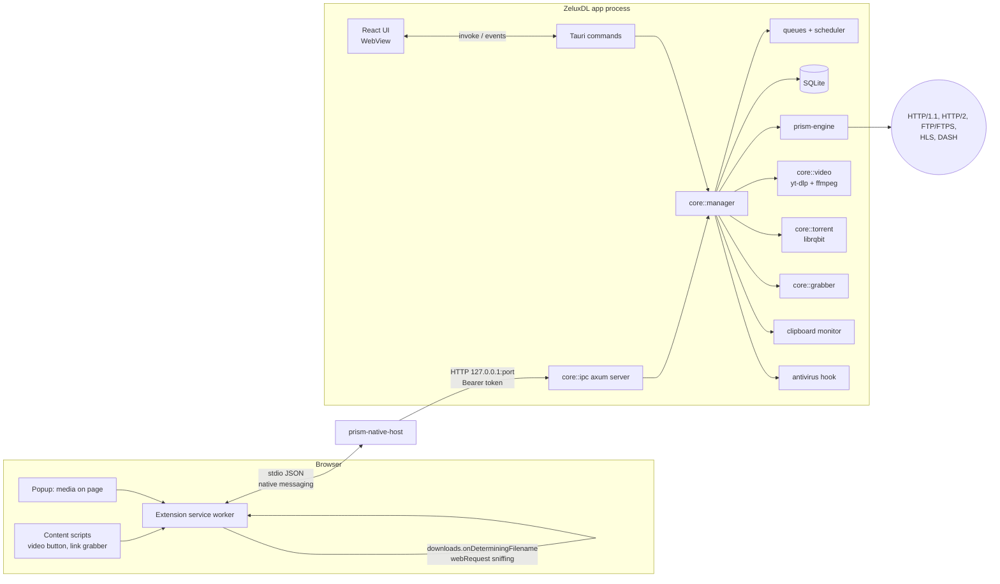

# ZeluxDL — Architecture

ZeluxDL is an open-source download manager in the spirit of Internet Download Manager (IDM):
a fast multi-segment engine, deep browser integration, video grabbing, and a premium "liquid glass" desktop UI.

## 1. Stack decisions

| Layer | Choice | Why |
|---|---|---|
| Download engine | **Rust** library crate `prism-engine` (tokio, reqwest 0.13 / hyper 1, rustls) | Memory-safe, async, zero-cost; positioned writes; easy to test in isolation. |
| Application core | Rust crate `prism-core` (rusqlite, axum, yt-dlp/ffmpeg management, librqbit) | All business logic (queues, scheduler, categories, grabber, IPC, video) is UI-agnostic and testable without a window. |
| Desktop shell | **Tauri 2.12** (`app/src-tauri`) | Tiny binaries, native WebView (WebView2 / WebKitGTK / WKWebView), tray, notifications, single-instance, autostart plugins. Tauri 3 is still alpha. |
| UI | **React 19 + TypeScript + Vite**, hand-written CSS with design tokens (CSS variables), `motion` for animation, `@tanstack/react-virtual` for the list, `zustand` for state | Fast iteration, mature ecosystem; CSS variables give us precise control over the glass material system. |
| Browser extension | **Manifest V3** (Chromium family) + Firefox build from the same TypeScript source | One codebase, two manifests. |
| Browser ↔ app | **Native messaging host** (`prism-native-host`, tiny Rust binary) → loopback HTTP to the app with a per-install bearer token | Native messaging is the only sanctioned channel from MV3; loopback keeps the host stateless and lets it auto-launch the app. |
| Video | **yt-dlp + ffmpeg**, managed (downloaded, checksum-verified, auto-updated) by `prism-core::video` | yt-dlp is the best-maintained extractor set; we accelerate plain HTTP formats with our own segmented engine. |
| Storage | **SQLite** (WAL, `synchronous=NORMAL`, checkpoints) | Crash-safe history, queues, settings and resumable segment state. |
| Torrent | **librqbit** (Apache-2.0) behind `prism-core::torrent` | Pure Rust, embeddable, magnet + .torrent, works on Windows/Linux/macOS. |

## 2. Repository layout

```
Cargo.toml                 workspace
crates/
  prism-engine/            download engine library (no UI, no DB)
  prism-core/              application core: manager, db, queues, scheduler, grabber, video, ipc, platform
  prism-native-host/       native messaging host binary (browser <-> app bridge)
  prism-testserver/        configurable local HTTP test server (throttle, drops, no-range, redirects, auth, limits) for tests + benchmarks
app/                       Vite + React UI
  src-tauri/               Tauri 2 shell (commands, events, tray, windows)
extension/                 MV3 extension (Chromium + Firefox builds)
design/                    moodboard + hi-fi mockups (design exploration)
docs/                      behavior report, research notes, design system, benchmarks, build docs
marketing/                 promo assets
packaging/                 installer hooks, native-messaging manifests, desktop files, flatpak
scripts/                   build / bench / release scripts
```

## 3. High-level component diagram



## 4. Engine design (`prism-engine`)

### 4.1 Download lifecycle

```mermaid
sequenceDiagram
  participant M as Manager
  participant E as Engine task
  participant W as Worker(s)
  participant S as Server
  M->>E: start(request, resume_state?)
  E->>S: GET Range: bytes=0- (probe; becomes worker #0's stream)
  S-->>E: 206 + Content-Range (or 200)
  E->>M: Event::Probed{size, name, resumable, etag, last_modified}
  E->>W: spawn up to N workers, each steals the largest remaining range
  loop until all ranges done
    W->>S: GET Range: bytes=a-b (keep-alive reused per worker)
    S-->>W: body chunks -> rate limiter -> positioned write
    W->>E: segment done -> steal: split largest remaining at midpoint
  end
  E->>E: flush + fsync, verify size, rename .prismpart -> final
  E->>M: Event::Completed
```

### 4.2 Key algorithms

* **Probe without an extra round trip.** The first request is `GET` with `Range: bytes=0-`. A `206` with `Content-Range` proves range support and gives the size; the same response body keeps streaming as the first segment. A `200` means no range support → single connection, non-resumable unless size + validators allow restart.
* **Dynamic segmentation (IDM-style work stealing).** A segment is `{start, pos, end}` where `end` is an `AtomicU64` that other workers may *shrink*. When a worker is idle it takes the segment with the largest `end - pos`, and if that remainder is `>= 2 * min_split` (default 512 KiB, 4 KiB aligned) it splits at the midpoint: the victim's `end` shrinks, the worker gets `[mid, old_end)`. A victim notices the shrunk `end` on its next chunk, writes up to it, and drops its connection (the server would keep sending bytes we no longer want). Result: every connection stays busy until the very end, and the slow tail is split down.
* **Connections.** Every worker owns its **own** `reqwest::Client` (HTTP/1.1 by default) so each segment is a separate TCP connection (multiple congestion windows beat HTTP/2 multiplexing for bulk throughput) and keep-alive reuse is deterministic: a worker that fully drained a bounded range reuses its socket for the next range. HTTP/2 can be enabled per download; HTTP/3 is an experimental compile-time feature.
* **Server connection limits.** If a non-first connection is refused (`429`, `503`, `403` after a successful probe, connect refused/reset before any byte), the engine lowers that download's target connection count to the number currently active, records the limit in a shared per-host `HostLimits` table (so later downloads start below it) and retries the failed worker later with exponential backoff.
* **Retries.** Transient errors (timeouts, resets, `5xx`, `429`, short reads) → exponential backoff with jitter (0.5 s · 2ⁿ, cap 30 s). A worker gives up after `max_retries` consecutive failures *without progress*; the download fails only when no worker can make progress. Fatal errors (`404`, `410`, `401` without credentials, disk full, validator mismatch) stop immediately with a typed error.
* **Resume.** `ResumeState` holds URL, final URL, total size, ETag, Last-Modified and the segment list. On resume, the first request carries `If-Range` (ETag if strong, else Last-Modified); if the server answers `200` instead of `206`, or size/ETag changed, the engine reports `ValidatorMismatch` and the manager asks the user to restart. State is checkpointed by the manager: `snapshot → fsync data → persist snapshot`, so the persisted state never claims bytes that are not on disk (crash and power-loss safe).
* **Disk I/O.** Data goes straight into `<final name>.prismpart` at its final offset (no temp-segment files, no slow merge/copy step); on completion it's fsynced and atomically renamed. Writes are positioned (`seek_write` on Windows, `write_all_at` on Unix) from a blocking pool in buffered chunks (default 1 MiB per worker). Windows: the file is marked **sparse** before `set_len` to avoid NTFS zero-fill stalls on out-of-order writes; Linux: `fallocate`. A free-space check runs before allocation.
* **Speed limiting.** Hierarchical token buckets: each worker acquires bytes from `[download, queue, global]` limiters (≤ 16 KiB per acquire). Limits are live-adjustable; `0` = unlimited.
* **Redirects, cookies, auth, proxy.** Redirects followed (max 10) and the final URL is reused by workers (falling back to the original URL if a signed redirect target expires). Cookies, Referer, User-Agent and arbitrary headers forwarded from the browser. Basic auth (reqwest), Digest (`digest_auth`, challenge/response), NTLM (`ntlmclient`, per-connection handshake — works because each worker owns one connection). Proxy: none / system / HTTP(S) / SOCKS5(h), per download or global.
* **Mirrors & URL refresh.** Workers are distributed round-robin across validated mirrors (same size/validators); a failing mirror is benched. `change_url()` swaps the address of a running/paused download after validating size (IDM's "Refresh download address").
* **No range support.** Single connection; on failure the download restarts from 0 (reported as `resumable: false`).
* **Integrity.** Optional MD5/SHA-1/SHA-256 verification after completion (streaming hash).
* **Other protocols.** FTP/FTPS via `suppaftp` (multi-connection using `REST` + `RETR`), HLS (`m3u8-rs`: master/variant selection, parallel segment fetch, AES-128 decryption, `EXT-X-MAP` fMP4, ffmpeg remux), DASH (`dash-mpd` parsing, parallel segment fetch, ffmpeg mux).

### 4.3 Public API contract (summary)

```rust
pub struct Engine;                          // cheap to clone (Arc inside)
impl Engine {
    pub fn new(config: EngineConfig) -> Engine;
    pub fn global_limiter(&self) -> &Arc<RateLimiter>;
    pub fn start(&self, req: DownloadRequest, resume: Option<ResumeState>,
                 limiters: Vec<Arc<RateLimiter>>) -> DownloadHandle;
    pub async fn probe(&self, req: &DownloadRequest) -> Result<ProbeInfo, EngineError>;
}
pub struct DownloadHandle {                 // control + observation of one job
    pub fn id(&self) -> Uuid;
    pub fn pause(&self);                    // graceful: workers stop, state flushed
    pub fn cancel(&self);
    pub fn set_connections(&self, n: u8);
    pub fn set_speed_limit(&self, bytes_per_sec: u64);
    pub fn change_url(&self, url: Url);
    pub fn snapshot(&self) -> ProgressSnapshot;   // segments, speed, eta
    pub fn resume_state(&self) -> Option<ResumeState>;
    pub fn events(&self) -> broadcast::Receiver<DownloadEvent>;
    pub async fn wait(self) -> Result<Completed, EngineError>;
}
```

Full Rust docs live in the crate (`cargo doc -p prism-engine`).

## 5. Application core (`prism-core`)

| Module | Responsibility |
|---|---|
| `db` | SQLite schema + migrations; repositories for downloads, categories, queues, schedules, grabber projects, settings (typed JSON). WAL mode. |
| `manager` | Owns all download items; maps items to engine/video/torrent jobs; queue admission; checkpoints resume state every 2 s; emits `CoreEvent`s (batched progress at 4 Hz). |
| `queue` / `scheduler` | Multiple queues with concurrency, speed limit, ordering; schedules (start/stop time, weekdays, once/daily); post-queue actions (exit, sleep, hibernate, shutdown, lock, command, sound). |
| `categories` | Built-in + custom categories, extension rules, per-category save folders. |
| `settings` | Typed settings with defaults; import/export JSON. |
| `ipc` | Loopback HTTP server (axum) for the native host; writes `ipc.json` (port + token) to the app data dir. |
| `video` | yt-dlp/ffmpeg locate/download/verify/update; `yt-dlp -J` format resolution; accelerated download path (engine for HTTP formats + ffmpeg mux/embeds) and yt-dlp fallback path. |
| `torrent` | librqbit session for magnet/.torrent. |
| `grabber` | Site crawler (depth, same-domain, filters, login), project persistence. |
| `clipboard` | Clipboard URL monitor. |
| `antivirus` | Post-download scan (Defender `MpCmdRun`, `clamscan`, custom command). |
| `platform` | OS abstractions: power actions, open/reveal, autostart, native-messaging registration (Windows registry / Linux+macOS manifest paths), free space. |
| `batch` | URL pattern expansion (`file[001-100].zip`, `[a-z]`), text-file import. |

## 6. Browser integration protocol

Extension → host → app messages are JSON objects `{ "type": ..., ... }`:

| type | Payload | Effect |
|---|---|---|
| `hello` | `{version, browser, installType}` | Returns app version + capture settings (extension list, MIME list, min size, excluded sites, bypass key). |
| `download` | `{url, referrer, cookies, userAgent, filename?, fileSize?, mime?, method?, postData?, headers?}` | App shows the **Download File** dialog (or adds silently per settings). |
| `batch` | `{items: [download...], pageUrl}` | "Download all links/images/videos" → selection dialog. |
| `video` | `{pageUrl, title?, streams: [{url, kind: hls|dash|direct, mime?, headers}], cookies, userAgent}` | Video panel / quality picker (yt-dlp for supported sites; sniffed streams otherwise). |
| `probeVideo` | `{pageUrl}` | Returns available formats (for the in-page button menu). |
| `status` | — | Health check for the integration status page. |

Host → app is `POST /v1/message` with `Authorization: Bearer <token>`; the host launches the app (`prism --background`) if `ipc.json` is missing or stale and waits up to 5 s.
Native messaging host name: `dev.prism.host`.

## 7. UI architecture

* Single main window (custom title bar, glass sidebar, dense table), plus secondary windows: **Download File dialog**, **progress/details window** (segment bars + speed graph), **completion dialog**, **mini window**, **drop zone**.
* Rust → UI: one `progress` event per 250 ms with all changed items (diff), plus discrete `item-added/updated/removed` events. UI → Rust: `invoke` commands.
* The list is virtualized (only visible rows mounted) → 1000+ items cost almost nothing.
* Design tokens in `app/src/design/tokens.css`, documented in `docs/design-system.md`.

## 8. Data model (SQLite, simplified)

```mermaid
erDiagram
  downloads ||--o{ download_segments : has
  categories ||--o{ downloads : classifies
  queues ||--o{ downloads : schedules
  queues ||--o{ schedules : uses
  grabber_projects ||--o{ downloads : produced
  downloads { text id PK; text url; text final_url; text file_name; text save_dir; int size; int downloaded; text status; text category_id; text queue_id; text resume_json; text request_json; int added_at; int finished_at; text description; text kind }
  categories { text id PK; text name; text icon; text extensions; text save_dir; int builtin }
  queues { text id PK; text name; int max_concurrent; int speed_limit; int position }
  schedules { text id PK; text queue_id; text json }
  settings { text key PK; text value }
```

## 9. Platform abstraction

All OS-specific code sits behind `prism-core::platform::{power, shell, autostart, native_messaging, fs}` with `#[cfg(windows)]`, `#[cfg(target_os = "linux")]`, `#[cfg(target_os = "macos")]` implementations, so the whole project builds on macOS (see `docs/BUILD_MACOS.md`).

## 10. Security notes

* The IPC server binds to `127.0.0.1` only and requires a 256-bit random bearer token stored in the user's app data dir.
* The extension only talks to the native host (no open ports exposed to web pages).
* Downloaded yt-dlp/ffmpeg binaries are SHA-256 verified against the publisher's checksum files before use.
