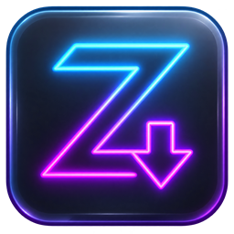
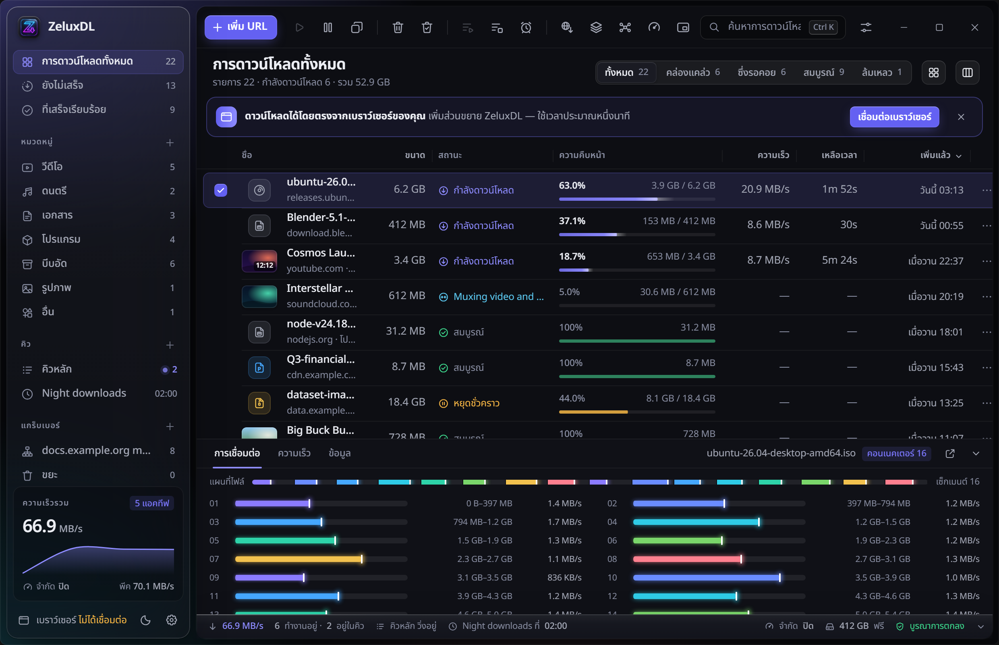
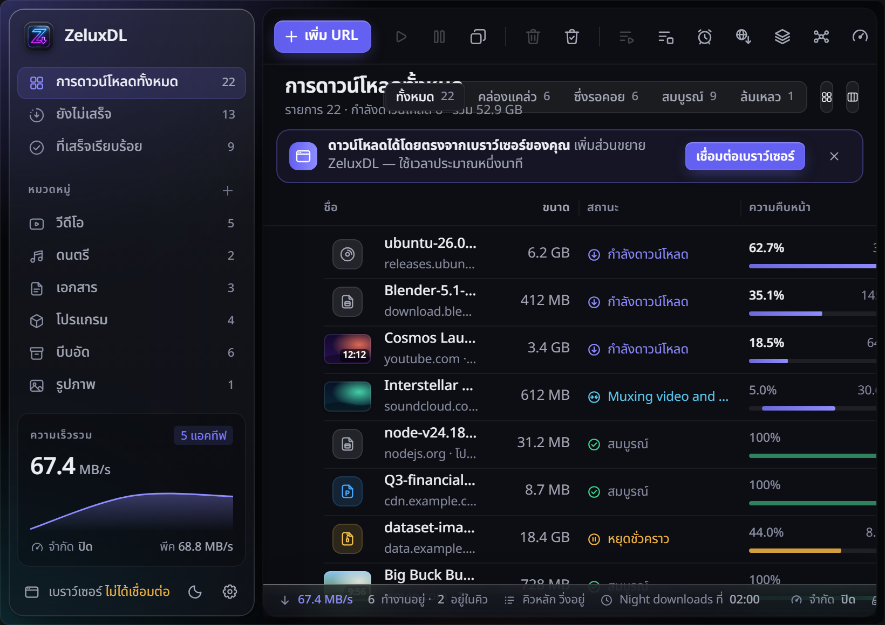
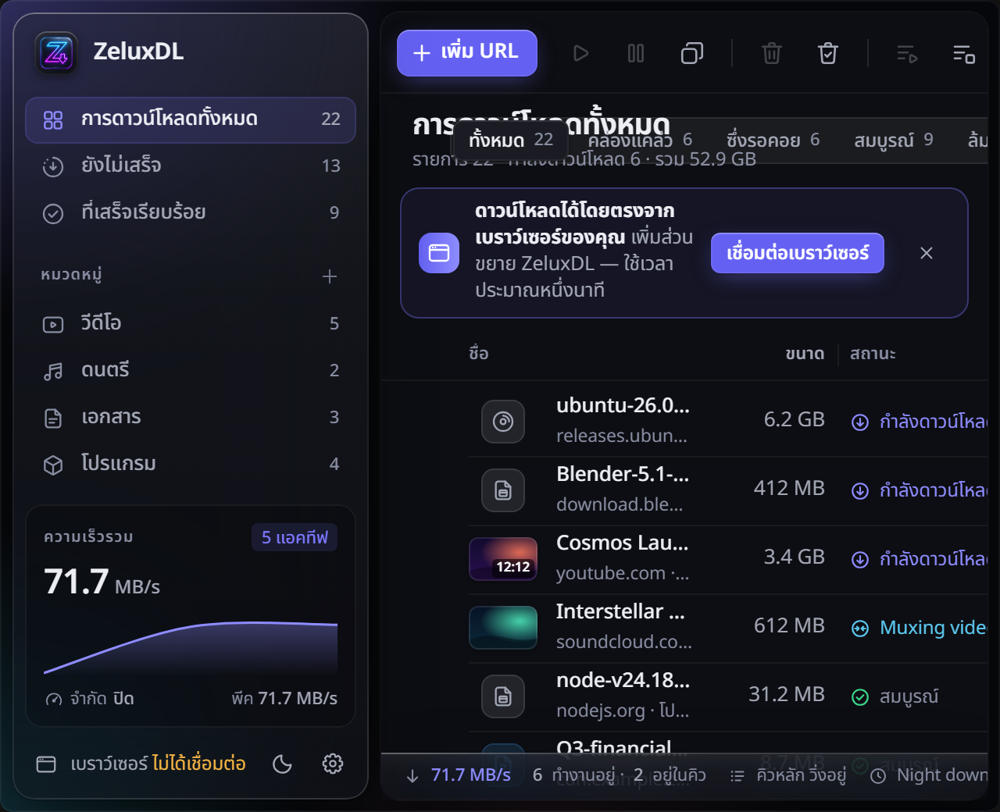
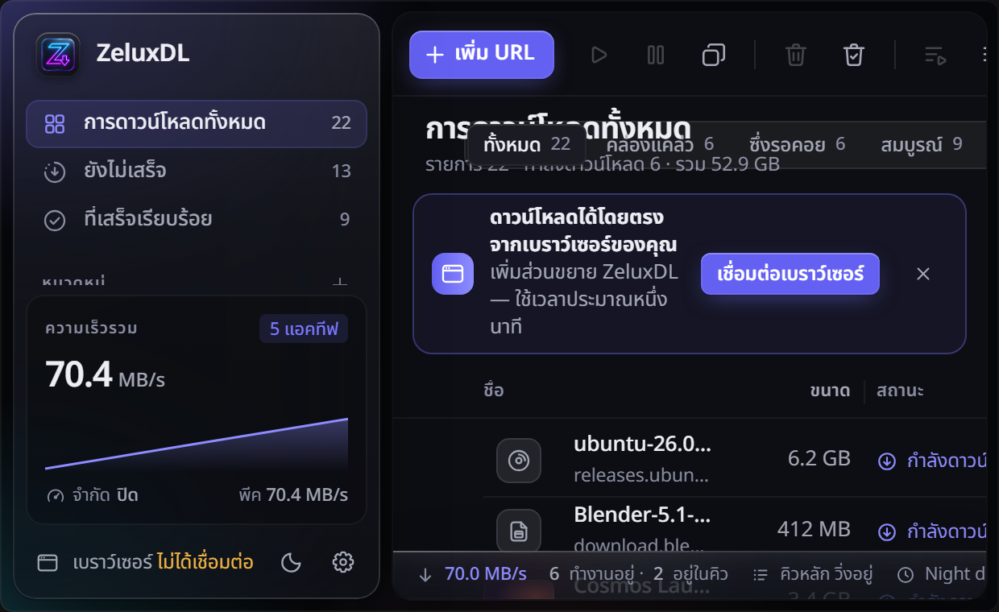
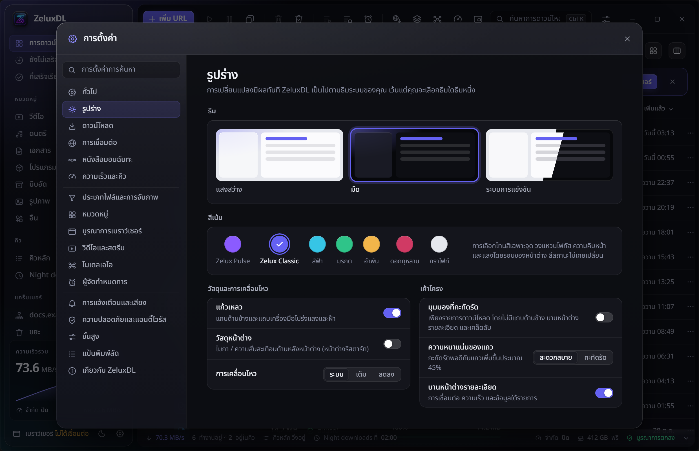
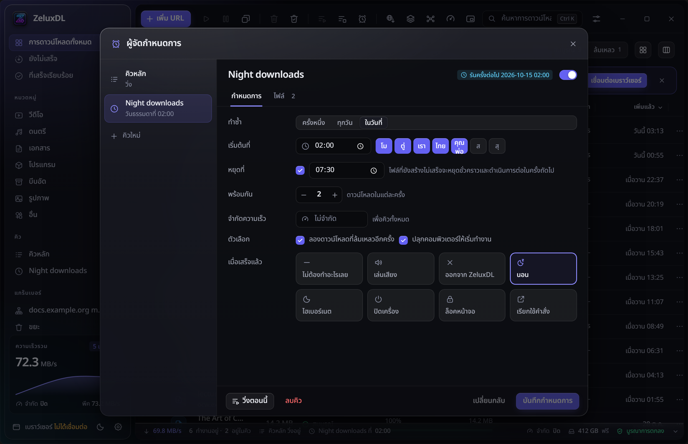

<p align="center">
  
</p>

<h1 align="center">ZeluxDL</h1>

<p align="center">
  <b>Next-Generation High-Speed Download Manager for Windows, macOS and Linux</b><br>
  โปรแกรมช่วยดาวน์โหลดไฟล์ความเร็วสูง สวยงาม ทรงพลัง และฟรี 100%
</p>

<p align="center">
  <a href="https://github.com/SMOKEx2/Zelux-DL/releases/latest"></a>
  <a href="LICENSE"></a>
  
  
</p>

<p align="center">
  <a href="https://github.com/SMOKEx2/Zelux-DL/releases/latest"><b>⬇ ดาวน์โหลดเวอร์ชันล่าสุด</b></a> ·
  <a href="#-จุดเด่นของ-zeluxdl">ฟีเจอร์เด่น</a> ·
  <a href="#-ภาพตัวอย่างโปรแกรม-screenshots">ภาพตัวอย่าง</a> ·
  <a href="#-การติดตั้งและใช้งาน">วิธีติดตั้ง</a>
</p>

<p align="center">
  
</p>

---

## 🌟 ทำไมต้อง ZeluxDL?

**ZeluxDL** คือโปรแกรมจัดการและเร่งความเร็วดาวน์โหลดรุ่นใหม่ที่พัฒนาขึ้นด้วย **Rust Core + Tauri 2 + React** ออกแบบมาเพื่อประสิทธิภาพสูงสุด กินทรัพยากรเครื่องน้อยมาก และมาพร้อมหน้าต่างอินเทอร์เฟซ Liquid Glassmorphism สุดล้ำในธีม **Zelux Pulse** สีม่วงนีออน 

ไม่ต้องเจอปัญหาโฆษณากวนใจ ไม่มีการบังคับสมัครสมาชิก ไม่มีระบบติดตามข้อมูล (Telemetry) และเป็นโอเพนซอร์ส 100%

---

## ⚡ จุดเด่นของ ZeluxDL

| ฟีเจอร์ | คำอธิบาย |
|---|---|
| 🚀 **Multi-Connection Turbo** | เร่งความเร็วการดาวน์โหลดสูงสุด **32 การเชื่อมต่อพร้อมกัน** พร้อมระบบ Dynamic Segmentation ที่แบ่งไฟล์ดาวน์โหลดอย่างต่อเนื่องจนถึงไบต์สุดท้าย |
| 🔗 **Multi-Host Resolvers** | ระบบแปลงลิงก์เว็บฝากไฟล์ยอดนิยมให้เป็นลิงก์โหลดตรงความเร็วสูงอัตโนมัติ (รองรับ Google Drive, Google Docs/Sheets/Slides, Dropbox `dl=1`, Pixeldrain, OneDrive, SharePoint, VikingFile, Hugging Face, GitHub) |
| 🖼 **Media Grid Picker** | หน้าต่างดาวน์โหลดไฟล์แบบกลุ่ม (Batch) อัปเกรดใหม่ สลับระหว่างโหมดตารางและ **โหมดการ์ดรูปภาพ (Grid View)** พร้อมพรีวิวรูปภาพขนาดย่อและการเลือกดาวน์โหลดที่ง่ายดาย |
| 🎬 **Smart Video & Music Grabber** | ดึงคลิปวิดีโอและเพลงจาก YouTube และเว็บสตรีมมิ่งกว่า **1,800+ เว็บไซต์** เลือกความละเอียดได้ตั้งแต่ 1080p, 2K, 4K ไปจนถึง 8K/HDR หรือจะแปลงเป็น MP3 ก็ทำได้ทันที |
| 🧲 **รองรับทุกโปรโตคอล** | ดาวน์โหลดได้ทั้ง HTTP(S), FTP/FTPS, HLS/DASH Streaming, BitTorrent และ Magnet links |
| 🔁 **Resume ได้เสมอ ไม่ต้องเริ่มใหม่** | เน็ตหลุด คอมดับ หรือปิดเครื่อง ZeluxDL สามารถดาวน์โหลดต่อจากจุดเดิมได้ทันที พร้อมตรวจสอบความถูกต้องของไฟล์อัตโนมัติ |
| 🌐 **เชื่อมต่อเว็บเบราว์เซอร์ลื่นไหล** | มาพร้อม Browser Extension สำหรับ Chrome, Brave, Edge, Opera และ Firefox คลิกดาวน์โหลดปุ๊บ สลับเข้า ZeluxDL ภายในเสี้ยววินาที |
| 💜 **Zelux Pulse Glassmorphism** | ดีไซน์อินเทอร์เฟซกระจกโปร่งแสง Glassmorphism พร้อมธีมเอกสิทธิ์ **Zelux Pulse (ม่วงนีออน)** สวยงาม สบายตา รองรับทั้ง Dark Mode และ Light Mode |
| 🇹🇭 **ภาษาไทยสมบูรณ์แบบ** | เมนูและข้อความแจ้งเตือนทั้งหมดแปลเป็นภาษาไทยอย่างถูกต้อง พร้อมฟอนต์ Noto Sans Thai อ่านง่าย สบายตา |

---

## 📸 ภาพตัวอย่างโปรแกรม (Screenshots)

<div align="center">

### 1. หน้าต่างหลักและการแสดงผล Multi-Connection Segmented Download
แสดงแถบความเร็วแบบเรียลไทม์ แผนผังการเชื่อมต่อ 16–32 ลำ พร้อมกราฟแสดงความเร็วเน็ต


<br><br>

### 2. Media Grid Picker (ระบบพรีวิวและเลือกภาพแบบกลุ่ม)
สลับมุมมอง Grid การ์ดรูปภาพ พร้อมระบบติ๊กเลือกและกรองนามสกุลไฟล์


<br><br>

### 3. ดาวน์โหลดวิดีโอและเลือกความละเอียด (Video Grabber)
เลือกฟอร์แมต MP4 / MP3 และปรับบิตเรตได้อย่างอิสระ


<br><br>

### 4. หน้าต่างเพิ่มลิงก์ (Add URL Dialog)
วางลิงก์ปุ๊บ ZeluxDL จะตรวจสอบลิงก์และดึงไฟล์ตรงทันที


<br><br>

### 5. ตั้งค่าธีม Zelux Pulse & การเชื่อมต่อเบราว์เซอร์
เลือกสไตล์สี Accent เช่น Zelux Pulse, Zelux Classic, Cyan, Emerald และตรวจสอบการเชื่อมต่อ Extension


<br><br>

### 6. ระบบคิวและตั้งเวลาดาวน์โหลด (Scheduler)
ตั้งเวลาให้เริ่มดาวน์โหลดตอนดึก และสั่งปิดเครื่องหรือ Sleep เมื่อดาวน์โหลดเสร็จ


</div>

---

## ⬇ การติดตั้งและใช้งาน

ดาวน์โหลดไฟล์ติดตั้งเวอร์ชันล่าสุดได้จากหน้า **[Releases](https://github.com/SMOKEx2/Zelux-DL/releases/latest)**

| ระบบปฏิบัติการ | ไฟล์ติดตั้ง | คำแนะนำ |
|---|---|---|
| **Windows 10 / 11 (64-bit)** | `ZeluxDL_<version>_x64-setup.exe` | **แนะนำ** ตัวติดตั้งแบบมาตรฐาน ติดตั้งง่าย ไม่ต้องใช้สิทธิ์แอดมิน |
| **Windows (MSI)** | `ZeluxDL_<version>_x64_en-US.msi` | สำหรับติดตั้งแบบ Enterprise หรือทุกผู้ใช้ในระบบ |
| **Windows Portable** | `ZeluxDL-<version>-windows-x64-portable.zip` | แตกไฟล์แล้วเปิดใช้งานได้ทันที พกพาใส่ Flash Drive ได้ |
| **Browser Extension** | `zeluxdl-chromium.zip` / `zeluxdl-firefox.zip` | ส่วนขยายสำหรับเบราว์เซอร์ Chrome, Brave, Edge, Opera, Firefox |

---

## 🧩 การติดตั้ง Browser Extension

1. แตกไฟล์ `zeluxdl-chromium.zip` (หรือ `zeluxdl-firefox.zip`) ลงในโฟลเดอร์ที่ต้องการ
2. เปิดเบราว์เซอร์ของคุณ ไปที่หน้าจัดการส่วนขยาย:
   - **Chrome / Brave:** `chrome://extensions` หรือ `brave://extensions`
   - **Edge:** `edge://extensions`
3. เปิดสวิตช์ **Developer mode (โหมดนักพัฒนา)** ที่มุมขวาบน
4. กดปุ่ม **Load unpacked (โหลดส่วนขยายที่แตกไว้)** แล้วเลือกโฟลเดอร์ส่วนขยาย
5. สัญลักษณ์ ZeluxDL จะปรากฏขึ้นบนแถบเบราว์เซอร์และแสดงสถานะ **เชื่อมต่อแล้ว (Connected)** 🚀

---

## 🛠 คอมไพล์จากซอร์สโค้ด (Build from Source)

### ข้อกำหนดก่อนเริ่ม:
- [Node.js](https://nodejs.org/) v20+ หรือ v24
- [Rust](https://rustup.rs/) (Stable Toolchain)
- Visual Studio C++ Build Tools (สำหรับ Windows)

```bash
# โคลนโปรเจกต์
git clone https://github.com/SMOKEx2/Zelux-DL.git
cd Zelux-DL

# ติดตั้ง Dependencies
npm ci --prefix app
npm ci --prefix extension

# คอมไพล์ Extension
npm run build --prefix extension

# คอมไพล์ Native Host Sidecar
node scripts/build-sidecar.mjs

# รันโหมด Development
cd app
npm run tauri dev

# บิวด์ Release ตัวติดตั้ง (EXE, MSI, Portable)
npm run tauri:build
```

---

## 📄 ใบอนุญาต (License)

โปรเจกต์นี้เผยแพร่ภายใต้ใบอนุญาต [MIT License](LICENSE) ใช้งานและพัฒนาต่อได้อย่างอิสระ
