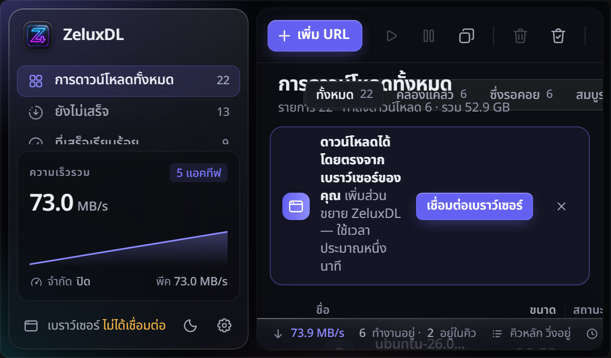
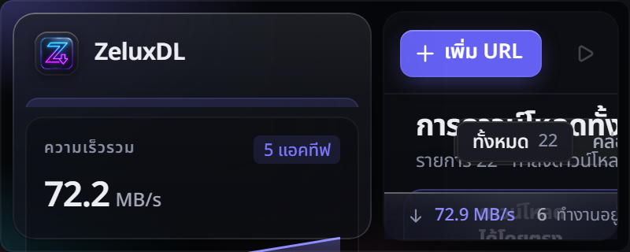

<p align="center">
  
</p>

<h1 align="center">ZeluxDL</h1>

<p align="center">
  <b>Next-Gen High-Performance Download Manager for Windows, macOS and Linux.</b><br>
  Multi-connection acceleration, video grabber, multi-host resolvers, and glassmorphic UI.
</p>

<p align="center">
  <a href="https://github.com/SMOKEx2/Zelux-DL/releases/latest"></a>
  <a href="LICENSE"></a>
  
</p>

<p align="center">
  <a href="https://github.com/SMOKEx2/Zelux-DL/releases/latest"><b>⬇ Download</b></a> ·
  <a href="docs/guide/installation.md">Install guide</a> ·
  <a href="docs/guide/browser-extension.md">Browser extension</a>
</p>

---

ZeluxDL splits every download into up to **32 parallel connections**, keeps them all busy until
the last byte, and survives crashes, sleep and pulled cables. Click a link in your browser and
ZeluxDL takes over; hover a video and grab it as **MP4 in the quality you want — or just the MP3**.
All of it in a calm, liquid-glass interface with dark, light, and exclusive Zelux Pulse themes.

Free, open source, no ads, no accounts, no telemetry.

## ✨ Why ZeluxDL

| | |
|---|---|
| ⚡ **Up to 15× faster** | On servers that throttle each connection, ZeluxDL's multi-connection engine is up to 15× faster than a normal browser download ([benchmarks](#-benchmarks)). |
| 🔗 **Multi-Host Resolvers** | Built-in direct link resolvers for Google Drive, Google Docs/Sheets/Slides, Dropbox (`dl=1`), Pixeldrain, OneDrive/SharePoint, VikingFile, Hugging Face, and GitHub. |
| 🖼 **Media Grid Picker** | Batch download window with live thumbnail grid view, quick card multi-selection, and filter by extension. |
| 🔁 **Never start over** | Pause, close the laptop, lose power — ZeluxDL resumes exactly where it stopped and checks that the file on the server hasn't changed. |
| 🌐 **Lives in your browser** | Chrome, Edge, Brave, Opera, Vivaldi and Firefox. Downloads jump into ZeluxDL in about a quarter of a second. |
| 🎬 **Video & music** | YouTube and [1,800+ sites](https://github.com/yt-dlp/yt-dlp/blob/master/supportedsites.md): MP4 up to 8K/HDR or MP3 only, with subtitles, chapters and SponsorBlock. |
| 🧲 **Every protocol** | HTTP(S), FTP/FTPS, HLS and DASH streams, BitTorrent and magnet links. |
| 🤖 **AI models** | Download models from [Hugging Face](https://huggingface.co) by name, link or search. ZeluxDL picks the files you need (one GGUF version, the weights in one format), downloads them over many connections and checks each against its SHA-256. |
| 🗂 **Organised** | Categories, queues with schedules and speed limits, "shut down when done", site grabber, batch downloads, clipboard monitor. |
| 🌍 **Your language** | Thai (ภาษาไทย), English, Czech, German, Spanish, French, Italian, Indonesian, Turkish, and Arabic. |
| 🎨 **Gorgeous** | Liquid-glass design, dark & light themes, exclusive **Zelux Pulse** neon violet theme, and compact mini window. |

<p align="center">
  
</p>

## ⬇ Download

Grab the file for your system from the **[latest release](https://github.com/SMOKEx2/Zelux-DL/releases/latest)**:

| System | File |
|---|---|
| **Windows** 10 / 11 | `ZeluxDL_<version>_x64-setup.exe` — recommended, no admin rights needed<br>`…_x64_en-US.msi` for all users · `…-windows-x64-portable.zip` for USB sticks |
| **macOS** 11+ Apple Silicon | `Prism_<version>_aarch64.dmg` |
| **macOS** 11+ Intel | `Prism_<version>_x64.dmg` |
| **Ubuntu / Debian / Mint** | `Prism_<version>_amd64.deb` |
| **Fedora / openSUSE** | `Prism-<version>-1.x86_64.rpm` |
| **Any Linux** | `Prism_<version>_amd64.AppImage` |

> **First start:** the installers are not code-signed (certificates cost money).
> Windows: *More info → Run anyway*. macOS: run `xattr -dr com.apple.quarantine /Applications/Prism.app`
> once (or *System Settings → Privacy & Security → Open Anyway*).
> Step-by-step for every system: **[Installation guide](docs/guide/installation.md)**.

## 🌐 Browser extension (1 minute)

**[Add Prism from the Chrome Web Store](https://chromewebstore.google.com/detail/prism-download-manager/mmcdeiglkbfbicdjboocmhehodogilfl)**
— Chrome, Edge, Brave, Opera, Vivaldi and Helium. Click **Add to Chrome**, pin the Prism icon, and it
says **Connected**. The store keeps it up to date.

Prism also walks you through this on first start (and any time from **Settings → Browser
integration**). Firefox, Edge/Opera notes, troubleshooting and privacy details:
**[Browser extension guide](docs/guide/browser-extension.md)**.

## 📸 Screenshots

| | |
|---|---|
|  |  |
| **Click a link** — Prism asks where to save it | **Grab a video** — MP4 + quality, or MP3 only |
|  |  |
| **Queues & scheduler** — download at night, then sleep | **Browser integration** — status and one-click repair |
|  |  |
| **Done** — open, show in folder, verify | **Mini window** — stays out of your way |

## 📊 Benchmarks

Same files, same machine, every result verified by SHA-256
([method & full results](docs/benchmarks.md)):

| Scenario | curl (1 connection) | aria2c | **Prism** |
|---|---|---|---|
| 1 GiB from a server that throttles each connection | 4.0 MiB/s | 61.0 MiB/s | **60.9 MiB/s** |
| 2 GiB, no network limit | 672 MiB/s | 324 MiB/s | **1029 MiB/s** |
| Server allows only 4 connections | 2.0 MiB/s | 8.0 MiB/s | **8.0 MiB/s** (max) |
| Server that randomly drops connections | — | ✘ gave up | **37.7 MiB/s** ✔ |
| Real internet, ≈ 200 Mbit/s line | 25.9 MiB/s | 25.2 MiB/s | **25.1 MiB/s** (line speed) |

## 🧠 How it works

<p align="center">
  
</p>

* **Dynamic segmentation.** When a connection finishes its part, it takes over half of the
  largest part still remaining — so every connection stays busy until the very end and the
  slow tail gets split down instead of waiting on one slow socket.
* **Server-aware.** Prism notices when a server refuses extra connections, settles on what it
  allows and remembers it per host.
* **Straight to disk.** Data is written directly into the final file (sparse on NTFS,
  pre-allocated on Linux) — no slow "assembling" step at the end.
* **Crash-safe.** Progress is checkpointed only after data is flushed to disk; on resume Prism
  validates size, ETag and Last-Modified with `If-Range`.
* **Rust + Tauri.** A Rust engine (tokio, rustls), a React UI in a native Tauri 2 shell — small,
  fast and memory-friendly.

Deep dive: [ARCHITECTURE.md](ARCHITECTURE.md).

## 🛠 Build from source

```bash
git clone https://github.com/FortoGraphy/prism-download-manager
cd prism-download-manager
npm ci --prefix app && npm ci --prefix extension
npm run build --prefix extension
cd app && npm run tauri:build
```

Prerequisites and platform notes: [BUILD.md](BUILD.md) (Windows, Linux) ·
[docs/BUILD_MACOS.md](docs/BUILD_MACOS.md) (macOS).

```text
crates/prism-engine       download engine: segmented HTTP/FTP, HLS/DASH, resume, speed limiter
crates/prism-core         app logic: manager, SQLite, queues, scheduler, grabber, browser IPC
crates/prism-video        yt-dlp / ffmpeg management, quality choices, muxing
crates/prism-torrent      BitTorrent / magnet
crates/prism-native-host  browser ↔ app bridge (native messaging) and browser registration
crates/prism-testserver   configurable HTTP server for tests and benchmarks
app/                      React UI + Tauri 2 shell
extension/                MV3 extension (Chromium + Firefox)
site/                     prismdl.site
```

## ❓ FAQ

<details><summary><b>Is it really free?</b></summary>

Yes. MIT-licensed, no ads, no trial, no account, no telemetry. The extension talks only to
the app on your own computer.
</details>

<details><summary><b>Windows / macOS says the app is unsafe.</b></summary>

The installers aren't signed with a paid certificate. The code is all here and every release
is built by GitHub Actions from this repository, with `SHA256SUMS.txt` to verify your file.
</details>

<details><summary><b>Can I use it together with IDM or another download manager?</b></summary>

Yes, but disable their browser extension — two extensions fighting over the same download
means neither works reliably.
</details>

<details><summary><b>Which sites can it download video from?</b></summary>

Every site supported by [yt-dlp](https://github.com/yt-dlp/yt-dlp), which Prism installs and
keeps up to date for you (together with ffmpeg). Please download only content you have the
right to download.
</details>

<details><summary><b>How do I download a model from Hugging Face?</b></summary>

Click the model button in the toolbar (or paste a model's name like `Qwen/Qwen3-8B`, or its link,
into *Add URL*). Pick a version if the model has several, and click *Download*: the files go into
the *Hugging Face* queue. For gated or private models, add an access token in Settings › AI models
(Prism also uses the one `hf auth login` saved). The token is sent only to Hugging Face, never to
the servers the files come from.
</details>

<details><summary><b>Does it work on Linux Flatpak/Snap browsers?</b></summary>

Flatpak browsers can't talk to desktop apps (a sandbox limitation). Use the deb/rpm version of
your browser for full integration.
</details>

## 🤝 Contributing

Bug reports, ideas and pull requests are very welcome — see [CONTRIBUTING.md](CONTRIBUTING.md).
If Prism saves you time, **a ⭐ on this repo helps more people find it.**

<a href="https://star-history.com/#FortoGraphy/prism-download-manager&Date">
  
</a>

## 📄 License

[MIT](LICENSE) for Prism's own code. Bundled and downloaded components keep their own licenses —
see [THIRD_PARTY.md](THIRD_PARTY.md).

<sub>Prism is an independent project. It is not affiliated with, endorsed by or derived from
Internet Download Manager or Tonec Inc.; all names are trademarks of their respective owners.</sub>
